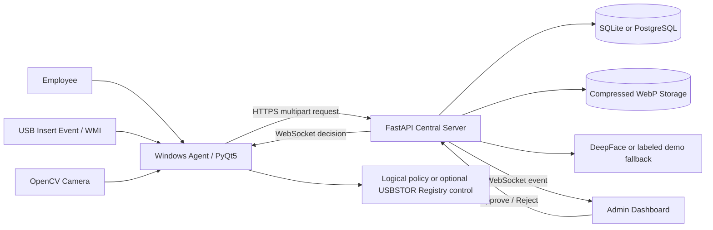

# Architecture

## Trust boundaries

1. Agent enrollment uses a shared prototype enrollment key.
2. After enrollment, the agent receives a scoped JWT.
3. Admins authenticate with username and password and receive an admin JWT.
4. Images are compressed to WebP and retained for 15 days by default.
5. The dashboard is served from the same FastAPI origin to simplify deployment.

## Why no Windows Service for the modal

Windows services run in Session 0. Interactive UI shown from a service is unsupported and unsafe. The delivered agent runs in the signed-in user's desktop and can be installed as a highest-privilege scheduled task at logon. A future production design can separate a privileged headless service from an unprivileged UI process using authenticated local IPC.
